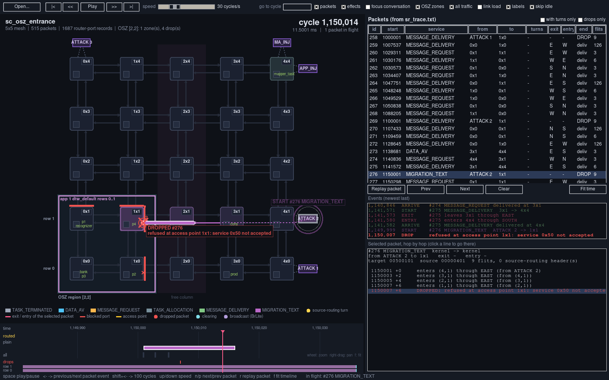
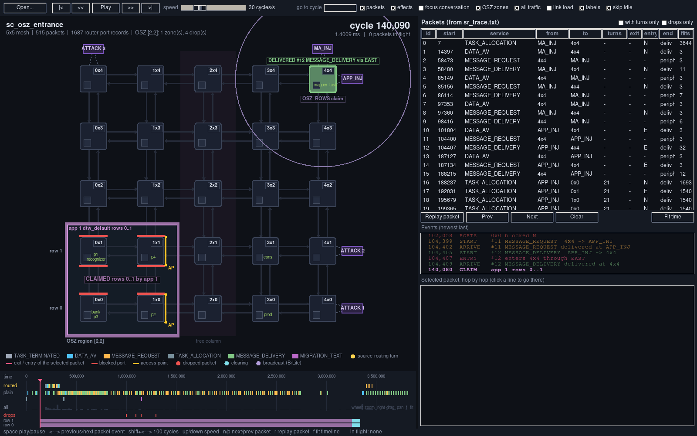
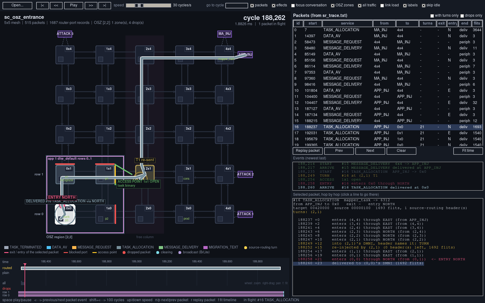
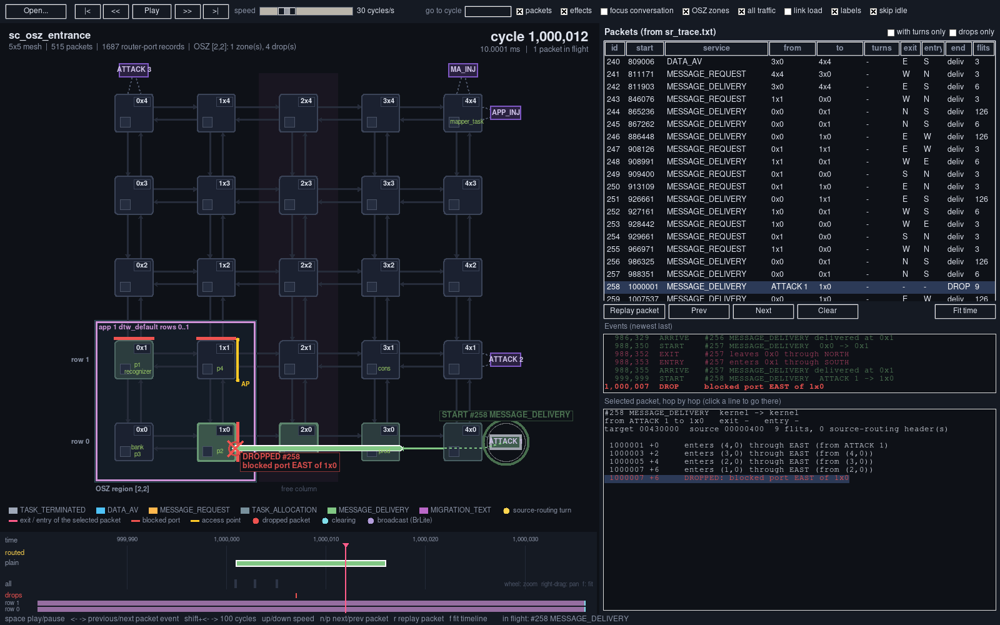
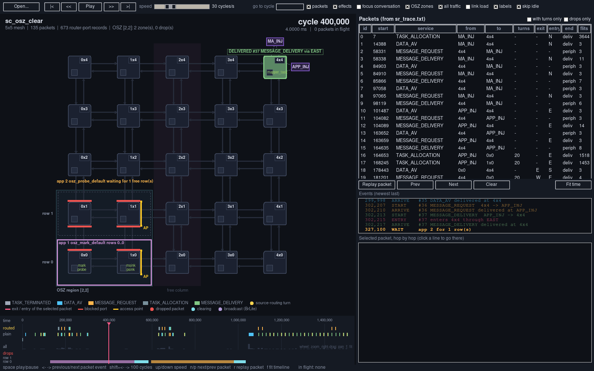
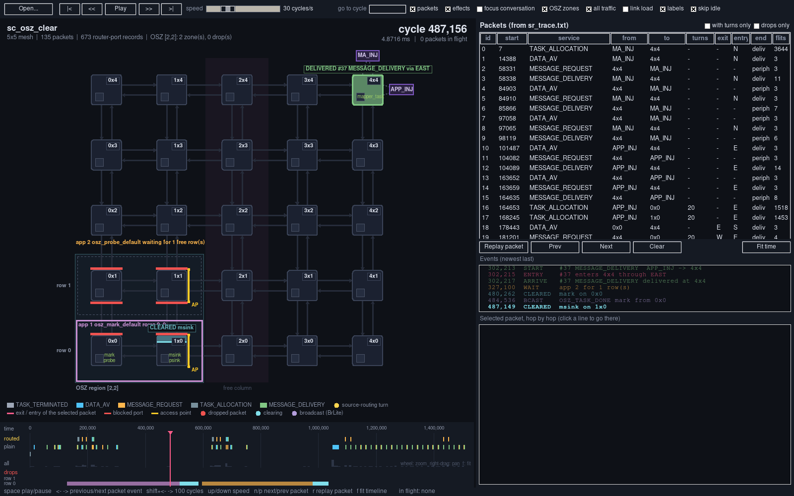
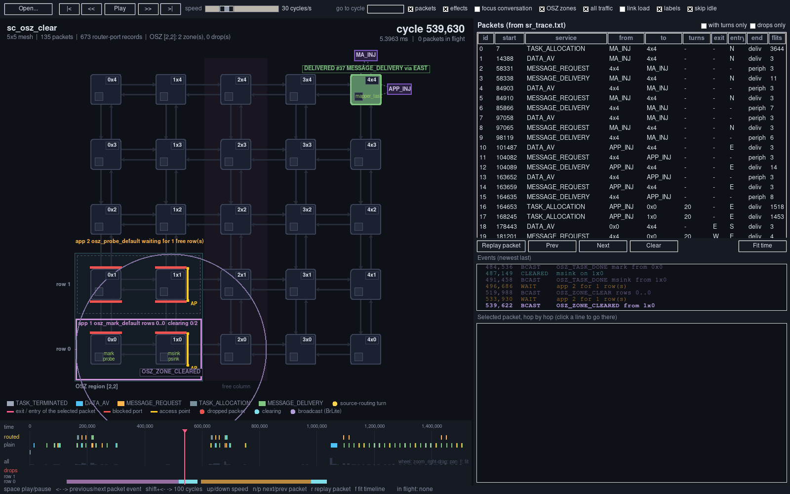
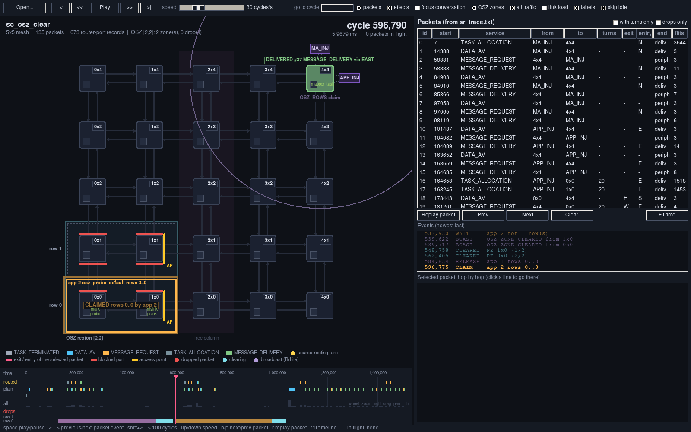

# meshviz: visual replay of the mesh, source routing and OSZ zones

`meshviz.py` replays a finished Memphis-V simulation on a picture of the mesh. It does the job of the Memphis
debugger (`Memphis_Debugger.jar`), built around two things the debugger cannot show:

- **source routing**: each packet is a moving "worm" as long as its flit count; its turns (the PEs whose DMNI takes
  the source-routing header off and sends the packet on) are animated, and its exit and entry ports are marked;
- **OSZ secure zones**: the region, the zones claimed by secure applications, the blocked ports (walls), the access
  point opening and closing, every packet dropped by a zone wrapper, the held tasks, the teardown broadcasts and the
  memory clearing.

Time is free: play, speed, step, jump, scrub and zoom.



## Running it

```sh
cd /sim/renato.sayyed/sandbox/STABLE/Memphis-V
python3 tools/meshviz/meshviz.py <testcase>/<scenario>
python3 tools/meshviz/meshviz.py ../osz_runs/attack/tc_osz_attack/sc_osz_entrance --journey 276
```

It needs an X display (`ssh -X` or `-Y`; check `echo $DISPLAY`) and only the Python standard library. The argument
is the scenario folder of a finished run (the one holding `debug/` and `log/`).

| Option | Effect |
| --- | --- |
| `<scenario>` | scenario folder of a finished run |
| `--journey N` | select packet N (its number in the packet list) and go to its start |
| `--time C` | start at cycle C |
| `--speed S` | replay speed in cycles per second (default 30; the slider goes from 1 to 1 000 000) |
| `--play` | start playing |
| `--heat` / `--no-traffic` | start with the link-load layer on / the all-traffic layer off |
| `--focus` / `--no-fx` | event effects only for the selected packet's conversation / effects off |
| `--no-zones` | start with the OSZ zone layer off |
| `--fps F` | redraws per second (default 30); lower it if the window is slow over `ssh -X` |
| `--geometry WxH` | window size (default 1500x900) |

**Open...** loads another scenario without restarting.

Without an X display, `tools/meshviz/viz_shot.sh <out.png> <seconds> <meshviz options>` takes a screenshot on a
virtual display (Xvfb, display `${VIZ_DISPLAY:-:79}`); it works in `tools/meshviz/.tmp` unless `TMPDIR` is set. The
pictures in `meshviz_shots/` were made with it.

### What the simulation must write

| File | Written by | Switch (testcase `hw: parameters:`) |
| --- | --- | --- |
| `debug/sr_trace.txt` | `Phivers/sim/SRTrace.sv`: every packet, hop by hop, with its source-routing headers | `SR_TRACE` (follows `TRAFFIC_DEBUG`, on by default) |
| `debug/osz_trace.txt` | `Phivers/sim/OszFilterTrace.sv` (zone wrappers) and `OszPeTrace.sv` (block register, kernel OSZ events) | `OSZ_TRACE` (follows `TRAFFIC_DEBUG`, on by default) |
| `debug/traffic_router.txt` | `Phivers/sim/TrafficRouter.sv` | `TRAFFIC_DEBUG` |
| `debug/platform.cfg`, `debug/services.cfg` | mint, unless run with `--skipdebug` | |
| `log/log<x>x<y>.txt` | the kernels and the mapper (task placement, the mapper's OSZ lines) | `UART_DEBUG` |

The monitors are **simulation only**: mint writes `` `define SR_TRACE `` / `` `define OSZ_TRACE `` into the
generated `PhiversPkg.sv`, and `PhiversTB.sv` attaches them with `bind` under `` `ifdef ``. No RTL file instantiates a
monitor; with `SR_TRACE: no` and `OSZ_TRACE: no` they are not even compiled.

A scenario run with `mint ... --skipdebug` has no `debug/platform.cfg` or `services.cfg`. meshviz then takes the mesh
size from the testcase's `PhiversPkg.sv` and the service names from its copy of `libmemphis/.../services.h`, but it
has no task or application names (numbers are shown instead). `regression/run_osz.sh` runs without `--skipdebug`.

## What is on the screen

| Element | Meaning |
| --- | --- |
| Rounded squares `XxY` | routers; the small square inside each is the PE's DMNI (local port) |
| Green text under a router | tasks allocated on that PE (from the PE logs) |
| Thin arrows between routers | the two links (one per direction), each on its own lane |
| Purple boxes outside the mesh | peripherals on boundary ports: the injectors and, in an attack testcase, `ATTACK 1..3` |
| **Worm** | a packet from `sr_trace.txt`: its head moves hop by hop at the logged times, its body is as long as the packet's flits, coloured by service (legend at the bottom) |
| Gold dots next to a worm's head | source-routing headers still in front of the packet: turns still to come |
| Spinning gold arc + "turn" | the packet is in a turn PE's DMNI, which takes the header off and sends the rest back into the router |
| Red cross at a worm's head | the packet was dropped by a zone wrapper (see OSZ below) |
| Coloured arrow on a lane | any packet (from `traffic_router.txt`) passing that link at that moment |
| Lane colour (link load on) | flits carried by that link so far, dark blue (few) to orange (most) |
| Selected packet | white outline, its whole path dashed, its turns circled and numbered `T1`, `T2`, and pink rings with "exit P" / "entry P" on the port where it leaves its origin and enters its destination |
| Top left | scenario, mesh, packet counts and, with a region, `OSZ [X,Y]: n zone(s), n drop(s)` |
| Top right | current cycle, the same time in ms (10 ns clock), packets in flight |
| Right panel | every packet: start cycle, service, from, to, turns, exit and entry port, how it ended (`deliv`, `periph`, `DROP`), flits; the Events box; the selected packet hop by hop |
| Timeline (bottom) | packets with turns ("routed"), other request/reply packets ("plain"), density of all traffic ("all"); with a region also the drops and one band per region row; the current time (pink) |

## OSZ secure zones

The **OSZ zones** checkbox (on by default, `--no-zones` to start without it) turns this whole layer on and off.

### State at the current cycle

| Element | Meaning | Source |
| --- | --- | --- |
| Dark blue background over PEs `0..X-1, 0..Y-1`, "row r" labels | the reserved region of `osz_window: [X,Y]` | `OSZ_WINDOW` in `PhiversPkg.sv` |
| Dark purple band over column X, "free column" | the free column, where packets into the zones turn | `OSZ_WINDOW` |
| Solid outline in the application's colour, "app N rows lo..hi" | the zone of a secure application: the rows it claimed, from the claim until the rows are released | mapper log |
| Dashed grey outline around a row | a free region row: always a one-row closed zone with its own access point | rows not claimed |
| Red wall across a port | that port is blocked: every packet through it is dropped whole | `BLOCK` lines (`DMNI_OSZ_BLOCK`) |
| Amber gate with two posts, "AP" | the access point (entrance) on the east port of PE (X-1, top row of the zone) | `BLOCK` bit 4 |
| Small red cross on a port, with a count | packets dropped there so far | `DROP` lines |
| "app N waiting for k free row(s)" above the region | a secure application the mapper could not place yet | mapper log |
| "HELD task until the zone closes" under a PE | a `TASK_RELEASE` that the kernel holds because the zone is not claimed yet | `KERNEL ev=TASK_HELD` / `TASK_RELEASED` |
| "clearing k/n" in the zone label, ✓ on a PE | the teardown: the mapper sent `OSZ_ZONE_CLEAR` and has the confirmation of k of the n PEs | mapper log |

### Events (effects)

All of them are a function of the current cycle only, like the packet effects: stepping, jumping or dragging the
timeline shows what playing shows.

| Event | Animation | Events box |
| --- | --- | --- |
| a port is blocked / opened | the wall rises (white, growing) or falls (fading), "ports blocked ..." under the PE | `PORTS 1x1 blocked N, access point E` |
| the access point holds a header | the gate pulses amber, "ACCESS POINT XxY / checking the source" | `ACCESS 1x1 checking source` |
| the access point lets a packet in | the gate turns green and swings open, "ACCESS POINT XxY OPEN / from XxY" (or "task binary") | `ACCESS 1x1 open` |
| a packet is dropped | red bursts and a large cross on the port, "DROPPED #id / blocked port ..." or "refused at access point ...: source / service / single-flit"; at an access point the gate stays closed in red; the worm stops there with a red cross | `DROP blocked port EAST of 1x0` |
| the mapper claims rows | the zone outline closes in from outside, "CLAIMED rows lo..hi by app N" in the zone; a broadcast ring `OSZ_ROWS claim` from the mapper PE | `CLAIM app 1 rows 0..1` |
| the mapper starts the teardown | the outline pulses, "clearing rows lo..hi"; ring `OSZ_ZONE_CLEAR` from the mapper PE; the zone's PEs glow cyan as they handle it | `BCAST OSZ_ZONE_CLEAR rows 0..1` |
| a kernel clears a task's memory | a cyan wipe runs down the PE, "CLEARED task" | `CLEARED prod on 0x0` |
| a kernel reports a task done / its PE cleared | broadcast ring `OSZ_TASK_DONE task` / `OSZ_ZONE_CLEARED` from that PE | `BCAST OSZ_TASK_DONE ...` |
| the mapper counts a cleared PE | ✓ on that PE, "clearing k/n" | `CLEARED PE 1x0 (1/2)` |
| the mapper releases the rows | the outline fades outwards, "RELEASED rows lo..hi"; ring `OSZ_ROWS release` | `RELEASE app 1 rows 0..0` |
| a zone broadcast from a PE that is not the mapper | the PE flashes red | `IGNORED zone broadcast from ...` |
| a task release held / released | the HELD label appears / goes | `HELD` / `RELEASED` |

Taken from the regression runs (`regression/run_osz.sh`): `attack` (`tc_osz_attack` + `sc_osz_entrance`) and
`clear` (`tc_osz` + `sc_osz_clear`).

| | |
| --- | --- |
|  cycle 140 090: app 1 (`dtw_default`) claims rows 0..1, `OSZ_ROWS` ring from the mapper; until the broadcast arrives the two rows are still separate one-row closed zones, each with its own access point |  cycle 188 262: task binary #16 turns at (2,1) in the free column, the access point of 1x1 lets it in (green, open), it goes down to 0x0 |
|  cycle 1 000 012: `ATTACK 1` sends #258 into 1x0 through its blocked east port: dropped whole |  cycle 1 150 014: `ATTACK 2` sends #276, service 0x50, to the access point: refused, the gate stays closed (red) |
|  cycle 400 000, `clear`: app 1 (`osz_mark`) owns row 0, row 1 is a free closed row (dashed, its own walls and access point), app 2 (`osz_probe`) waits for a row |  cycle 487 156: `msink` is removed from 1x0 and its memory wiped (cyan wipe, "CLEARED msink") |
|  cycle 539 630: 1x0 has cleared its PE for the teardown and reports it, `OSZ_ZONE_CLEARED` ring; the zone counts "clearing 0/2" until the mapper takes the report in |  cycle 596 790: row 0 released and claimed again by app 2, `OSZ_ROWS claim` ring; on the timeline row 0 goes from app 1's colour to cyan (teardown) to app 2's |

### Packet list and hop detail

- The **end** column says how each packet ended: `deliv` (to a DMNI), `periph` (to a peripheral) or `DROP`.
- **drops only** above the list keeps only the dropped packets; `n`/`p` then step through them.
- The hop detail names the applications of the sender and receiver tasks as secure or not secure, and ends a dropped
  packet with the `DROPPED:` line (click it to go there).

### Timeline

Below the packet rows: `drops` (one red tick per dropped packet) and one band per region row, in the colour of the
application that owns it, turning cyan from the moment the mapper starts the teardown until it releases the rows.

## Packet event effects

Every packet (a "communication") is told as a sequence of events. **effects** turns them on and off; **focus
conversation** restricts them to the selected packet's conversation (all packets between its two endpoints).

| Event | When | Animation |
| --- | --- | --- |
| START | the packet leaves its origin (a PE's DMNI or a peripheral) | the origin flashes in the service colour, an expanding ring, "START #id service" (0.9 s) |
| target | while the packet is in flight | a dashed ring pulses around the destination, "target of #id" |
| EXIT | the packet leaves its origin router | a pink ring on the exit port, "EXIT port" (0.9 s) |
| PASS | the head enters a router | that router flicks in the service colour (0.45 s) |
| TURN | the packet sits in a turn PE's DMNI | the router glows gold, two arcs spin, a gold header falls into the DMNI, "TURN Tk at (x,y): source-routing header consumed" |
| re-sent | the turn PE re-injects the packet | a gold burst from the DMNI and "Tk re-sent" (0.8 s) |
| ENTRY | the head enters the destination router | pink pulse on the entry port, "ENTRY port" (0.9 s) |
| ARRIVE | the packet is delivered (or leaves to its peripheral) | the destination flashes white and three rings expand (1.3 s) |
| delivered (stays) | after the arrival | the destination stays lit, "DELIVERED #id service via port" |
| reset | the next communication starts | the lit destination fades out (0.6 s) |

A dropped packet has no ARRIVE: its end is the drop effect of the OSZ layer.

## Controls

| Action | Mouse / button | Key |
| --- | --- | --- |
| Play / pause | **Play** | space |
| Previous / next event (a hop of any packet, or an OSZ event) | `<<` / `>>` | left / right arrow |
| Back / forward 100 cycles | | shift + left / right |
| Speed x2 / /2 | speed slider | up / down |
| Start / end of the simulation | `\|<` / `>\|` | Home / End |
| Go to a cycle | type it in "go to cycle", Enter | |
| Jump to a time | click or drag on the timeline | |
| Zoom / pan the timeline | mouse wheel / right-drag | `f` fits it to the selected packet (or to the whole run) |
| Select a packet | click it in the list, or click its head on the mesh | `n` / `p` next / previous packet |
| Replay the selected packet from its start, stop at its end | **Replay packet** | `r` |
| Go to one hop of the selected packet | click that line in the hop list | |
| Skip idle time while playing | "skip idle" (on by default): when nothing is in flight and no effect is running, playback jumps to just before the next event | |
| Only packets with turns / only dropped packets | "with turns only" / "drops only" above the list | |

## Decisions

| # | Decision | Reason |
| --- | --- | --- |
| 1 | **tkinter**, single file, standard library only | The only GUI toolkit installed in this Python (Tk 8.6); no installation, and Tk works over `ssh -X`, like the JAR. |
| 2 | **Packets (worms) come from `debug/sr_trace.txt`** | It is the only file that records, at every router input and every router-to-DMNI link, how many source-routing headers the packet still carries (`nsr`), the next one (`sr0`), and the real header/source/IDs that identify the same packet before and after each turn. |
| 3 | `SRTrace` logs **every** packet and sits on the RX side of each mesh link, **before** the zone wrapper | Every mesh port of every PE has a wrapper (`PhiversOszFilter`), so binding there covers the whole mesh; a dropped packet is still seen arriving at the port that drops it. |
| 4 | Background traffic and link load come from `debug/traffic_router.txt` | It is the file the JAR reads. BrLite lines (odd port code) are skipped. `TrafficRouter.sv` skips leading source-routing headers, so the service and target are those of the real packet. |
| 5 | Mesh size and task/application names from `debug/platform.cfg`, service names from `debug/services.cfg`; fallbacks from `PhiversPkg.sv` and `services.h` | Generated by mint; the fallbacks let `--skipdebug` runs open too. |
| 6 | Task placement from the PE logs (`Task id N allocated`) | No debug file records it; the kernel prints it at allocation. |
| 7 | Peripherals, region and attackers from the testcase's generated `Phivers/sim/PhiversPkg.sv` (`ADDR_*`, `PORT_*`, `OSZ_WINDOW`, `OSZ_ATTACK`) | It is what the hardware was built with; the YAML may have changed since. The attacker positions are the ones of `PhiversMC.sv`. |
| 8 | **Packet reconstruction**: lines with the same (header, source, IDs) form one stream; a packet continues on a router input or a DMNI delivery, and on a LOCAL re-injection at the PE whose DMNI just received it with headers (a turn); it ends at a delivery with no header left; any other LOCAL injection starts a new packet | The same rule as the SOURCE_ROUTING checkers. On the OSZ regression every hop it builds goes through the applications' entrances, as `osz_check.py` asserts. |
| 9 | A drop ends the journey with the same identity key whose last hop is at the dropping port, before the drop | The `DROP` line carries the same (hdr, src, ids) as `sr_trace.txt`. |
| 10 | **Monitors only in simulation, behind `` `ifdef ``**, attached with `bind` from `PhiversTB` | As required: the RTL never instantiates a monitor. The wrapper only exposes plain status signals (`ev_drop`, `ev_hold`, `ev_accept`, ...), unused by the RTL itself. |
| 11 | Kernel OSZ events through one store to a debug register (`MMR_DBG_OSZ`, offset 0x70 of the debug area): `{event, data}` | The debug area already carries the kernel's log output; one store costs a few cycles where a `printf` costs thousands and would shift the timing being shown. |
| 12 | **Zones from the mapper log, walls and access points from the block register** | The mapper decides the zones (claim, teardown, release); the hardware state is what each PE's `DMNI_OSZ_BLOCK` holds. Showing both makes the delay between a decision and the ports changing visible (see the claim picture). |
| 13 | Every monitor counts cycles from reset itself | A monitor bound into the wrapper cannot reach the PE's `mtime`. The counter equals `mtime` (the RTC counts every cycle from the same reset and is never written): on `sc_osz_entrance` 1 132 router-input packets have exactly the same cycle in `sr_trace.txt` and `traffic_router.txt`; the others are the 22 headers held at the access point (the router sees them after the source check) and the 4 dropped packets (the router never sees them). |
| 14 | **Timing**: the head is at a router input at the cycle logged for that hop and moves linearly in between; the body is the last `flits` cycles of that motion | The logs give the time of each header, not of each flit. Exact for the head; assumes no stall for the body. |
| 15 | Inside a router the worm stays on its lane if it goes straight and turns at the corner where the two lanes cross | Shows the real port pairs without crossing the router diagonally. |
| 16 | Exit = side of the origin towards the first router entered; entry = last input port of the destination router before delivery | The same definitions as the checkers. |
| 17 | Dark theme, one colour per service, gold for turns, pink for exit/entry, red for walls and drops, amber/green for the access point, cyan for clearing, lilac for BrLite | The OSZ and source-routing information must stand out from the service colours. |
| 18 | Default speed 30 cycles/s with idle skipping | A hop takes 2 cycles: at 30 cycles/s each hop is visible for about 70 ms; the long idle gaps (thousands of cycles of software) are skipped. |
| 19 | Effects are a function of the simulation time only, with durations in wall-clock seconds | Stepping or jumping shows what playing shows; a flash lasts the same on screen at any speed. |
| 20 | One access-point state at a time (the latest of hold / open / refused) | The wrapper handles one packet at a time; drawing an older "checking" over a newer "open" was misleading. |
| 21 | OSZ labels grow away from the port they describe (east of an E port, above an N port) | Centred labels covered the zone's own PEs. |
| 22 | While effects (packet or OSZ) are running, idle skipping waits for them to finish | Otherwise the jump to the next packet would cut the drop or clearing effect. |

## Differences from the Memphis debugger

| | Memphis debugger (JAR) | meshviz |
| --- | --- | --- |
| Time | runs or steps one packet; "Go" only moves backwards | play at any speed, pause, step any event backwards or forwards, jump to any cycle, scrub and zoom, replay one packet |
| Packets | one at a time; links turn red once used | every packet in flight drawn as a worm with its length; several at once |
| Source routing | not shown | headers left, turns T1/T2, exit and entry ports |
| OSZ | not shown | region, zones, walls, access point, drops, held tasks, teardown and clearing |
| Statistics | per-router traffic table, service filter, scheduling and log tabs | per-link load colour; the packet list with route, exit, entry, end, size |

## Limitations

- Body length assumes one flit per cycle; a stalled packet keeps its logged head times, but its body is drawn as if
  flowing.
- Two packets with the same header, source and IDs in flight at the same time would be merged.
- BrLite broadcasts are not drawn as packets; the OSZ ones appear as rings at the moment the kernel or the mapper
  reports them (`OSZ_TASK_DONE`, `OSZ_ZONE_CLEARED` from the kernel; `OSZ_ROWS`, `OSZ_ZONE_CLEAR` from the mapper).
- The mapper's times are those of its log lines, a little after the decision (the claim line is printed after the
  mapping; the "cleared k/n" lines after each `OSZ_ZONE_CLEARED` is processed).
- The task names under a router are every task that PE ran in the whole simulation, not only the current ones (on a
  reused row they mix both applications: `mark probe` on 0x0 in `clear`).
- The HELD badge is not exercised by the regression scenarios (no `TASK_RELEASE` arrives before its zone is
  claimed there).
- Scenarios run before `SRTrace` / `OszFilterTrace` existed open with zones (from the mapper log) but no worms and no
  walls.

## Checks done

- The three monitors build with Verilator `-Wall` with the macros on and off; with `SR_TRACE: no` / `OSZ_TRACE: no`
  the generated `PhiversPkg.sv` has no macro and no trace file is written.
- `sc_osz_entrance` on `tc_osz_attack`: 4 `DROP` lines (2 blocked ports, 2 refused at the access point), the same 4
  drops `osz_check.py` counts; each matched to its journey from `ATTACK 1..3`.
- Cycle alignment with `traffic_router.txt` (decision 13).
- Rendering smoke test on a virtual display: every OSZ event time and 1, 5, 20, 60 cycles after it, with the
  layers on and off, plus selecting packets and the drops-only list, on all seven regression cases and on a run
  with the monitors off: no exception, at most 19 ms per frame; on every case the drops equal `osz_check.py`'s count
  and each is matched to its packet. The cases without a region (`noosz`, `dirty`) open with no OSZ layer.
- The screenshots above, taken with `viz_shot.sh` from the regression runs.
